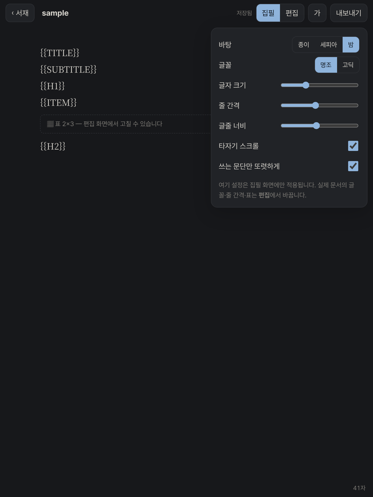
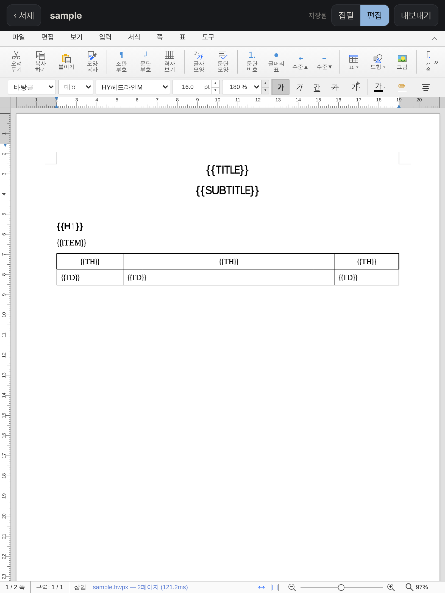

# 집필실

아이패드에서 **집중해서 글을 쓰고**, 다 쓴 뒤 **한글(HWPX) 서식으로 다듬는** 웹앱입니다.
문서 엔진은 오픈소스 [rhwp](https://github.com/edwardkim/rhwp)(Rust + WebAssembly, MIT)를 씁니다.

| 집필 화면 | 편집 화면 |
| --- | --- |
|  |  |

## 두 가지 화면

- **집필** — 글자만 보입니다. 쓰기 시작하면 도구 막대가 사라지고, 쓰는 문단만 또렷해지며,
  커서 줄이 늘 같은 높이에 머뭅니다(타자기 스크롤). 바탕(종이·세피아·밤), 글꼴, 크기는
  화면용 설정일 뿐 문서 서식은 건드리지 않습니다. 표·그림은 자리 표시만 됩니다.
- **편집** — rhwp 편집기가 열립니다. 글꼴·글자 크기·굵게·줄 간격·정렬·문단 모양,
  표 만들기와 줄/칸 추가·삭제·셀 합치기 등을 실제 쪽 모양을 보며 고칩니다.

위쪽 `집필 | 편집` 버튼(또는 키보드 `⌘E`)으로 오갑니다. 집필에서 글자를 고쳐도 편집에서 준
서식은 그대로 남습니다(바뀐 글자만 엔진에 전달하기 때문).

문서는 기기 안에 자동 저장되고, **내보내기**를 누르면 `.hwpx` 파일로 꺼낼 수 있습니다.
`.hwp` 파일도 열 수 있지만 내보낼 때는 HWPX가 됩니다.

## 아이패드에 설치하기

웹앱(PWA)이라 앱스토어·맥·개발자 계정이 필요 없습니다. 웹 주소만 있으면 됩니다.

1. GitHub 저장소 → **Settings → Pages** → *Build and deployment*의 Source를
   **Deploy from a branch**로, 브랜치와 `/ (root)`를 고르고 **Save**.
   (비공개 저장소는 유료 요금제에서만 Pages가 됩니다. 무료라면 저장소를 공개로 바꾸거나
   Netlify·Cloudflare Pages 같은 다른 정적 호스팅에 이 폴더를 그대로 올리세요.)
2. 1~2분 뒤 표시되는 주소(`https://<아이디>.github.io/<저장소>/`)를 아이패드 **Safari**로 엽니다.
3. 공유 버튼(□↑) → **홈 화면에 추가**. 홈 화면의 "집필실" 아이콘으로 열면 주소창 없이 전체 화면으로 뜹니다.

처음 열 때 엔진·글꼴(약 60MB)을 내려받고, 그 뒤로는 인터넷 없이도 열립니다.

## 내 컴퓨터에서 실행해 보기

[Node.js](https://nodejs.org) 18 이상이 필요합니다.

```bash
npm start
```

브라우저에서 <http://localhost:8080> 을 엽니다. 자동 점검은 서버를 켜 둔 채 다른 터미널에서:

```bash
npm test
```

(점검은 Playwright와 Chromium이 설치된 환경이 필요합니다.)

## 폴더 구성

| 경로 | 내용 |
| --- | --- |
| `index.html`, `css/`, `js/` | 집필실 본체. `js/app.js`(화면 동작), `js/engine.js`(엔진 연결·글자 동기화), `js/store.js`(기기 저장) |
| `studio/` | 빌드된 rhwp 편집기(편집 화면). 직접 고치지 않습니다 |
| `vendor/` | rhwp 엔진 JS(`@rhwp/core`)와 편집기 연결 SDK(`@rhwp/editor`) |
| `scripts/build-studio.sh` | rhwp 새 버전으로 `studio/`·`vendor/`를 다시 만드는 스크립트 |
| `sw.js`, `manifest.webmanifest`, `icons/` | 홈 화면 설치·오프라인 지원 |
| `tests/` | 자동 점검 |

## 알아둘 점

- **실제 아이패드에서는 아직 확인하지 못했습니다.** 개발 환경에서는 Chromium으로 아이패드
  크기·터치를 흉내 내어 점검했습니다. Safari에서 편집 화면의 화면 키보드 한글 입력, 표 조작이
  매끄러운지는 직접 써 보며 확인이 필요합니다(외장 키보드가 있으면 더 안정적입니다).
- 편집기가 켜진 직후 문서가 그려지지 않는 rhwp 0.9.0의 타이밍 문제가 있어, 앱이 그려졌는지
  확인하고 안 됐으면 다시 넘기도록 해 두었습니다(`js/app.js`의 `loadIntoStudio`).
- 한컴 전용 글꼴(함초롬바탕 등)은 기기에 없으므로 화면에서는 비슷한 공개 글꼴로 보입니다.
  파일에는 원래 글꼴 이름이 그대로 저장됩니다.
- 문서는 브라우저 저장소에 있습니다. Safari 방문 기록·웹사이트 데이터를 지우면 함께 사라지니
  중요한 글은 **내보내기**로 파일을 남겨 두세요.
- 한글(한컴오피스)에서 여는 호환성은 rhwp의 HWPX 저장 품질을 따릅니다. 중요한 양식 문서는
  내보낸 뒤 한글에서 한 번 열어 확인하세요.

## 라이선스 고지

rhwp와 포함된 글꼴·서드파티 고지는 `studio/LICENSE`, `studio/THIRD_PARTY_LICENSES.md`,
`studio/fonts/`, `vendor/rhwp-core/notices/`에 있습니다. "한글", "HWP", "HWPX"는
주식회사 한글과컴퓨터의 등록 상표이며, 이 앱은 한글과컴퓨터와 무관한 독립 프로젝트입니다.
